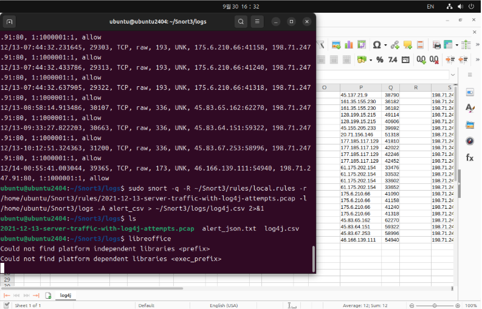

# Snort PCAP 분석과 CSV 확인

노션의 기존 실습 이미지 원본을 2026.11.09 확보해 추가했습니다. 이번에 새로 실행한 결과가 아니며 촬영자와 독립 수행 범위는 화면만으로 확인할 수 없습니다.

## 화면에서 확인한 사실

터미널 작업 경로에 Snort3/logs가 보입니다. Snort를 `-q -R ...local.rules -r ...server-traffic-with-log4j-attempts.pcap ... -A alert_csv`로 실행하는 명령, alert_json.txt·log4j.csv 파일 목록, CSV를 연 스프레드시트가 보입니다.

## 결론의 범위

`1:1000001:1`과 allow 표시가 보이지만 규칙 본문과 원본 PCAP이 없습니다. 파일명에 Log4j가 있다는 사실만으로 실제 악용 성공이나 탐지 정확성을 확정할 수 없습니다. 화면의 PCAP 파일명 날짜와 교육 기간은 서로 다를 수 있으며 캡처 연도는 확정하지 않습니다.

## 출처와 무결성

- [노션 원문](https://app.notion.com/p/2ae09f14126e800a8e7ae19738a000ea)
- 저장 파일: `evidence/notion-original.png`
- SHA-256: `01b393930d59b18caba826c1790bb06b489a8520c7dfbe774879e6056598ca91`
- 원본 수정 없이 첨부했습니다. 입력된 비밀번호·토큰은 화면에 보이지 않습니다. 로컬 사용자명·경로와 실습 데이터 주소는 화면에 포함되어 있습니다.

이 캡처에 보이지 않는 추가 성과는 주장하지 않습니다.
