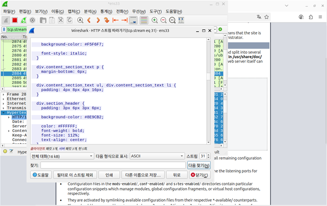

# HTTP 스트림 확인

노션의 기존 실습 이미지 원본을 2026.11.09 확보해 추가했습니다. 이번에 새로 실행한 결과가 아니며 촬영자와 독립 수행 범위는 화면만으로 확인할 수 없습니다.

## 화면에서 확인한 사실

Wireshark의 HTTP 스트림 따라가기 창과 `tcp.stream eq 31` 필터가 보입니다. CSS/HTML 텍스트와 Apache 기본 안내 페이지 일부가 확인됩니다.

## 결론의 범위

웹 통신 내용을 스트림으로 확인한 근거입니다. SQL Injection·XSS·IDOR 공격 성공이나 Burp Suite·Juice Shop 사용은 이 캡처만으로 입증되지 않습니다.

## 출처와 무결성

- [노션 원문](https://app.notion.com/p/2ae09f14126e804c8f73d5a75e0047b4)
- 저장 파일: `evidence/notion-original.png`
- SHA-256: `b9a3b7e8d627fd02b60daa396a53282d22a40467892d05e9d20eff71f4030c0b`
- 원본 수정 없이 첨부했습니다. 입력된 비밀번호·토큰은 화면에 보이지 않습니다. 로컬 사용자명·경로와 실습 데이터 주소는 화면에 포함되어 있습니다.

이 캡처에 보이지 않는 추가 성과는 주장하지 않습니다.
