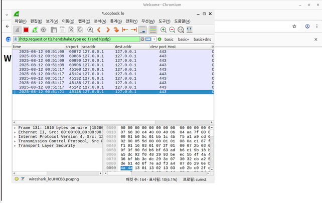

# 루프백 TLS 트래픽 확인

노션의 기존 실습 이미지 원본을 2026.11.09 확보해 추가했습니다. 이번에 새로 실행한 결과가 아니며 촬영자와 독립 수행 범위는 화면만으로 확인할 수 없습니다.

## 화면에서 확인한 사실

Wireshark에서 출발지와 목적지가 127.0.0.1이고 목적지 포트가 443인 패킷 목록, 선택 패킷의 Transport Layer Security 계층이 보입니다. 창 제목은 Loopback: lo입니다.

## 결론의 범위

TLS 패킷을 확인한 근거입니다. 인증서 검증 완료, 전체 페이로드 암호화 검증, Nmap 스캔 또는 방화벽 차단 성공을 입증하지 않습니다. 화면 패킷 시각은 2025.08.12로 보여 기존 교육 기간 시작일과 하루 차이가 있습니다.

## 출처와 무결성

- [노션 원문](https://app.notion.com/p/28b09f14126e8181a60fd570e2e95489)
- 저장 파일: `evidence/notion-original.png`
- SHA-256: `2d4b9b166472736b959cee7b94c47995eb9352900150974d86cff1064e1120bd`
- 원본 수정 없이 첨부했습니다. 입력된 비밀번호·토큰은 화면에 보이지 않습니다. 로컬 사용자명·경로와 실습 데이터 주소는 화면에 포함되어 있습니다.

이 캡처에 보이지 않는 추가 성과는 주장하지 않습니다.
