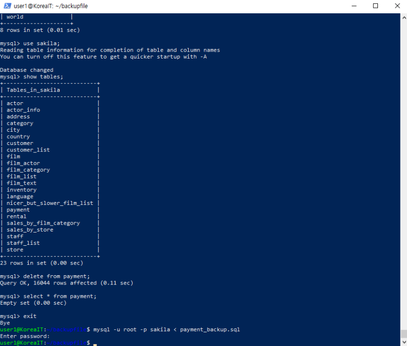

# MySQL 테이블 조회와 백업 파일 가져오기

노션의 기존 실습 이미지 원본을 2026.11.09 확보해 추가했습니다. 이번에 새로 실행한 결과가 아니며 촬영자와 독립 수행 범위는 화면만으로 확인할 수 없습니다.

## 화면에서 확인한 사실

MySQL에서 `use sakila;`, `show tables;` 실행과 23개 테이블 목록이 보입니다. payment 테이블 삭제 후 `16044 rows affected`, 이어진 조회의 `Empty set`이 보입니다. 셸에는 `mysql -u root -p sakila < payment_backup.sql` 실행 후 프롬프트 복귀가 보입니다.

## 결론의 범위

SQL 파일 가져오기 명령까지의 근거입니다. 가져오기 후 SELECT·COUNT 결과는 없어 16044건 복원 완료라고 단정하지 않습니다. 계정 권한 축소·TLS·Prepared Statement·컬럼 암호화를 입증하지도 않습니다. 삭제 명령은 화면 해설이며 실행 안내가 아닙니다.

## 출처와 무결성

- [노션 원문](https://app.notion.com/p/2ae09f14126e8034a883c2c6ec15f0b9)
- 저장 파일: `evidence/notion-original.png`
- SHA-256: `b76e287418c8086c55a33855d91616ca0f1eea8082c59cc3d5347373b22b7156`
- 원본 수정 없이 첨부했습니다. 입력된 비밀번호·토큰은 화면에 보이지 않습니다. 로컬 사용자명·경로와 실습 데이터 주소는 화면에 포함되어 있습니다.

이 캡처에 보이지 않는 추가 성과는 주장하지 않습니다.
